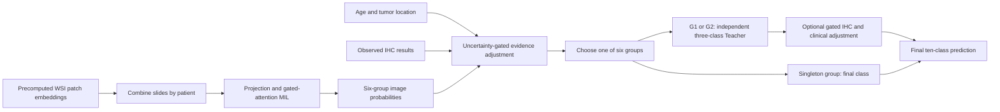

# PBT: Hierarchical Classification from WSI Embeddings

Patient-level pediatric brain tumor research with frozen whole-slide image
embeddings, gated-attention multiple-instance learning, and selective use of
clinical and immunohistochemical evidence.

**Code-only release.** The team's patient data, slide identifiers, embeddings,
clinical records, IHC observations, original folds, trained weights, predictions,
and study reports are not distributed. The runnable example generates entirely
fictional data locally.

## What is included

- **Flat classifiers:** binary, six-group, and ten-class attention MIL.
- **Joint hierarchical models:** the original three-group hard-routing model,
  the cross-group global head, and validation-based epoch selection with a fresh
  fit on the full outer training partition.
- **Strict six-to-ten hierarchy:** a six-group image Teacher followed by two
  independently trained three-class Teachers. A child cannot change its parent.
- **Selective evidence fusion:** four settings—WSI, WSI + age/location,
  WSI + IHC, and WSI + both—reuse the same image checkpoints.
- **Training variants:** fixed epochs, early stopping, label smoothing, AdamW,
  dropout, smaller models, tempered class weights, focal loss, lower learning
  rate, and increased patch sampling.
- **Historical research components:** residual correction, class-specific
  attention, and CREDIT/credal-distillation model and loss modules.

The public runner consolidates the original experiment scripts into a portable
package. It preserves the central model and evidence calculations, but removes
machine-specific paths, private cohort adapters, and fixed patient-count
assertions. This is not a byte-for-byte replay of the private experiment archive.
See [experiment provenance](docs/experiments.md) for the distinction.

## Pipeline



## Quick start

Python **3.10 or 3.11** is supported. The source experiments and local release
checks use TensorFlow 2.14; the dependency range also allows TensorFlow 2.15.

```bash
python3.11 -m venv .venv
source .venv/bin/activate
python -m pip install -e .

python -m unittest discover -s tests -v
pbt demo --config configs/hard6to10_fixed25.json --output outputs/demo
```

The demo uses small random feature matrices, three synthetic patient folds, and
two epochs per model to check the complete workflow. Its metrics are software
test output, **not clinical performance**. All demo artifacts are ignored by Git.
Use a new output directory for each run; completed artifacts are not overwritten.

## Use your own authorized data

Prepare the JSON manifest described in [data format](docs/data_format.md).
All slides from one patient must appear in a single record. Embeddings are read
from an HDF5 dataset named `features`, shaped `[patches, feature_dim]`. The
default dimension is 768 for the existing CONCH feature workflow.

```bash
pbt make-splits --manifest private/manifest.json --folds 5 \
  --output private/splits.json

pbt validate --config configs/hard6to10_fixed25.json \
  --manifest private/manifest.json --splits private/splits.json --check-features

pbt run --config configs/hard6to10_fixed25.json \
  --manifest private/manifest.json --splits private/splits.json \
  --output outputs/hard6to10
```

Split generation creates new stratified patient folds. To reproduce a previous
study's partition, supply that study's locally retained split file in the
documented schema instead. No private split membership is bundled here.

For a direct six-group comparison:

```bash
pbt run-suite --manifest private/manifest.json --splits private/splits.json \
  --configs configs/flat6_01_fixed25.json configs/flat6_02_early_stopping.json \
  --output outputs/flat6_comparison
```

Each variant completes every fold before the next variant starts. See the
[configuration guide](docs/experiments.md) for all 18 presets.

Predict with one saved fold on a manifest whose labels may be omitted:

```bash
pbt predict --run-dir outputs/hard6to10 --fold 0 \
  --manifest private/new_patients.json --output outputs/new_predictions.json
```

## Six-group taxonomy

| Group | Original classes | Broad description |
|---|---|---|
| G1 | C1, C2, C3 | Low-grade glial, high-grade glial, and glioneuronal tumors |
| G2 | C4, C6, C8 | High-grade embryonal, uncertain-histogenesis, and pineal tumors |
| G3 | C5 | Ependymal tumors |
| G4 | C7 | Choroid plexus tumors |
| G5 | C9 | Non-glial tumors |
| G6 | C10 | Non-tumor |

These are experimental groupings of broad project labels, not an official WHO
classification or a claim that group members share one biological lineage.
Only G1 and G2 need a second-stage classifier. Six-group accuracy and final
ten-class accuracy are evaluated separately.

## Evaluation and evidence

The current evidence pipeline trains image networks on **WSI embeddings only**.
Age/location and IHC adjust calibrated scores after image inference, only when
the image prediction is uncertain. Marker likelihoods and clinical category
likelihoods use training patients only; temperatures and evidence strengths use
inner validation only. Test labels never select these settings.

Fixed-25 configurations use 25 epochs and a 50-epoch cosine learning-rate
horizon. Early stopping monitors unweighted validation NLL and restores the
best checkpoint without a full-pool refit. Historical epoch selection is a
different protocol and is documented separately.

Reports include accuracy, balanced accuracy, macro F1, confusion matrices, and
per-class recall. Hard-routing errors give zero probability to the true class;
their infinite NLL is recorded explicitly, not replaced by a finite score.
Cross-validation on a repeatedly studied cohort is not independent external
validation. This repository does not publish private-cohort performance claims.

## Repository layout

```text
src/pbt/
  data.py, splits.py       Patient bags and leakage checks
  models/                 Shared MIL layers, flat and joint hierarchical models
  evidence/               Root cues, IHC likelihoods, child clinical evidence
  training.py             Fixed epochs, early stopping, selection and refit
  pipeline.py              Serial training, fusion and held-out evaluation
  inference.py             Saved-model inference
  legacy/                  Historical CREDIT models and CED loss
configs/                   Portable experiment presets
examples/                  Fictional manifest and legacy component examples
tests/                     Synthetic checks for data, models and inference
docs/                      Methods, data schema, experiments and privacy
tools/check_public_tree.py  Publication allowlist and sensitive-content checks
```

## Documentation

- [Methods and evidence rules](docs/methods.md)
- [Data schema and label conventions](docs/data_format.md)
- [Experiments and source provenance](docs/experiments.md)
- [Data privacy and release boundary](docs/privacy.md)
- [Method references](docs/references.md)
- [中文说明](docs/README_zh.md)

## Acknowledgments

The workflow builds on [attention-based MIL](https://proceedings.mlr.press/v80/ilse18a.html)
and precomputed pathology foundation-model features such as
[CONCH](https://github.com/mahmoodlab/CONCH). The historical CREDIT components
implement ideas from [credal ensemble distillation](https://arxiv.org/abs/2511.13766).
Foundation-model weights and extraction software are obtained separately under
their respective terms. See [NOTICE](NOTICE.md) for the release's licensing scope.
